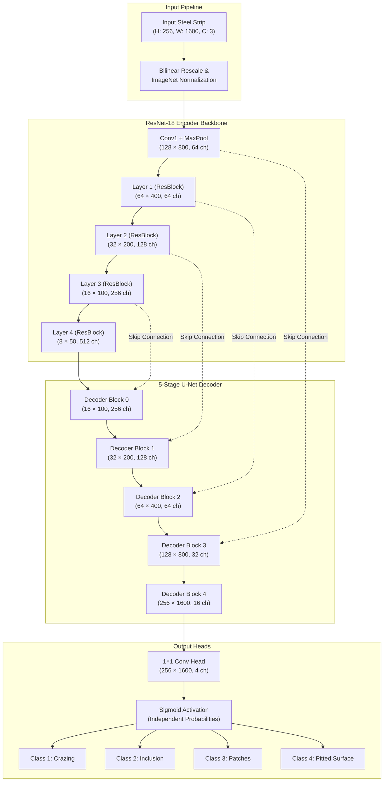

# SteelSight — AI-Powered Steel Surface Defect Segmentation

[](https://steelsight-euz7hu4qudbz6ydybfkxmf.streamlit.app/)
[](https://github.com/kumarrishuraj/SteelSight/releases/tag/v1.0.0)
[](https://www.python.org/)
[](https://pytorch.org/)
[](LICENSE)

---

### 🚀 Live Demo

**[🌐 Open SteelSight Live Application](https://steelsight-euz7hu4qudbz6ydybfkxmf.streamlit.app/)**

The live interactive application is deployed on Streamlit Community Cloud and runs real-time deep learning inference directly on CPU instances.

---

## 📌 Project Overview

**SteelSight** is an industrial-grade computer vision system engineered to detect, segment, and quantify surface defects on continuous rolled sheet steel in real time.

In modern metallurgical manufacturing, rolled steel strips move across production lines at high velocities. Surface anomalies—such as pitting, scratches, inclusions, and rolling cracks—must be rapidly isolated before coil winding and downstream fabrication. SteelSight deploys semantic segmentation using a deep convolutional neural network:

- **ResNet-18 Encoder Backbone**: Extracts hierarchical feature representations across 5 residual stages.
- **Custom U-Net Decoder**: Reconstructs spatial fidelity using lateral skip connections to preserve high-frequency defect boundaries.
- **4 Independent Defect Channels**: Segments multiple co-occurring defect classifications via independent sigmoid activation heads.
- **Pixel-Level Localization**: Generates discrete defect segmentations across extreme-aspect-ratio strip images ($1600 \times 256$ px).
- **Multi-Modal Visualizations**: Renders confidence heatmaps, 45% alpha color overlays, and per-class binary isolation masks.
- **Automated Defect Metrics**: Quantifies affected pixel areas and percentage surface coverage for quality reporting.

```
+--------------------------------------------------------------------------------------------------+
|                                    Continuous Steel Strip (1600 × 256)                          |
+--------------------------------------------------------------------------------------------------+
                                                 │
                                                 ▼
+──────────────────────────────────────────────────────────────────────────────────────────────────+
|  Class 1: Crazing (Coral Red)            Class 2: Inclusion (Mint Green)                        |
|  Class 3: Patches (Sky Blue)             Class 4: Pitted Surface (Amber Yellow)                 |
+──────────────────────────────────────────────────────────────────────────────────────────────────+
```

---

## ✨ Features

- **Multi-Format Image Ingestion**: Supports uploading industrial surface captures in `.jpg`, `.jpeg`, `.png`, `.webp`, and `.bmp` formats up to 15 MB.
- **Adjustable Sensitivity Threshold**: Dynamic slider ($0.05$ to $0.95$, default $0.50$) allowing operators to tune sensitivity between high recall for quality screening and high precision for critical defect verification.
- **Standardized Strip Alignment**: Automatically resizes and scales uploaded imagery to the benchmark model dimension ($1600 \times 256$ px) with ImageNet tensor normalization.
- **Color-Coded Overlay View**: Alpha-blends defect masks at 45% transparency over the raw strip surface texture with distinct color codes:
  - **Class 1 (Crazing)**: Coral Red (`#FF4154`)
  - **Class 2 (Inclusion)**: Mint Green (`#45D49A`)
  - **Class 3 (Patches)**: Sky Blue (`#42B8FF`)
  - **Class 4 (Pitted Surface)**: Amber Yellow (`#F0B45C`)
- **Confidence Heatmap**: Projects maximum-probability activation across all channels using the OpenCV Inferno colormap to reveal sub-threshold defect stress concentrations.
- **Individual Class Masks**: Separates predictions into 4 dedicated binary channels (white defect mask on black background) for isolated defect inspection.
- **Quantitative Defect Metrics**: Automatically tabulates pixel counts, percentage surface area occupied, and detection presence for every class.
- **Downloadable High-Res Artifacts**: Enables one-click exports of all visualization layers directly from the browser for metallurgical audit trails.
- **Premium Industrial UI**: Custom dark-mode interface inspired by modern automated manufacturing cockpits, featuring responsive tab navigation and interactive controls.

---

## 🧠 Model Architecture & Training

The core segmentation network is based on a U-Net topology paired with a ResNet-18 encoder. Residual skip connections route early spatial activations directly from encoder layers to expanding decoder stages, preventing vanishing gradients and preserving microscopic boundary contours.

### Architecture Specifications

| Component | Specification |
|:---|:---|
| **Encoder** | ResNet-18 (pre-trained on ImageNet) |
| **Decoder** | 5-stage U-Net decoder with lateral skip connections |
| **Decoder Channels** | `(256, 128, 64, 32, 16)` |
| **Input Dimensions** | $256 \times 1600$ px (3 RGB channels) |
| **Output Activation** | 4 independent Sigmoid channels (Multi-label binary classification) |
| **Loss Function** | Binary Cross Entropy with Logits (`torch.nn.BCEWithLogitsLoss`) |
| **Optimizer** | Adam (`lr = 5e-4`) with `ReduceLROnPlateau(patience=3)` |
| **Training Budget** | 20 Epochs |
| **Best Checkpoint** | Epoch 18 (`best_loss: 0.01176`) |
| **Dataset Benchmark** | Severstal Steel Defect Detection Corpus |

### Mermaid Architecture Diagram



---

## 🛠 Technology Stack

- **Core Runtime**: Python 3.10+
- **Deep Learning Framework**: PyTorch 2.x (CPU-optimized for cloud deployment)
- **Application Framework**: Streamlit (Standalone deployment)
- **Computer Vision**: OpenCV (`opencv-python-headless`), Pillow (`PIL`), NumPy
- **Neural Network Architecture**: ResNet-18, U-Net encoder-decoder
- **Model Checkpoint Distribution**: GitHub Releases asset hosting with automated SHA-256 verification

> **Note on Architecture Evolution:** The repository contains earlier FastAPI backend and React frontend iterations used during local development. The deployed cloud production system runs as a self-contained, standalone Streamlit application (`streamlit_app.py`) for zero-latency in-memory inference without multi-process overhead.

---

## 📂 Project Structure

```
steelsight/
├── streamlit_app.py           # Main interactive Streamlit application with custom industrial UI
├── requirements.txt           # Deployment Python dependencies (Streamlit, PyTorch CPU, Pillow, OpenCV)
├── README.md                  # Comprehensive project documentation
├── .gitattributes             # Git LFS tracking configuration
├── .gitignore                 # Exclusion rules for local artifacts and checkpoints
│
├── backend/                   # Core inference engine and configuration modules
│   ├── __init__.py
│   ├── config.py              # System constants, secrets bridge, threshold bounds, and release URL
│   ├── inference.py           # Model loading, automated checkpoint download, SHA-256 verification
│   ├── schemas.py             # Data schema models for validation
│   └── tests/                 # Automated pytest validation suite
│       ├── test_health.py
│       ├── test_prediction.py
│       └── test_validation.py
│
├── model/                     # Deep learning model definition and local weights
│   ├── __init__.py
│   ├── model.py               # PyTorch ResNet-18 U-Net network topology
│   └── model.pth              # Checkpoint file (172 MB, Git LFS tracked / release asset)
│
├── dataset/                   # Dataset labels and sample imagery
│   ├── train.csv              # Severstal defect run-length encoded annotations
│   └── train_images/          # Sample production steel strip captures
│
└── notebooks/                 # Training, exploration, and evaluation notebooks
    └── unet-starter-kernel-pytorch-lb-0-88.ipynb
```

---

## 💻 Installation and Local Setup

Follow these steps to run SteelSight locally on a Windows workstation:

### 1. Clone the Repository

```cmd
git clone https://github.com/kumarrishuraj/SteelSight.git
cd SteelSight
```

### 2. Create and Activate a Virtual Environment

```cmd
python -m venv venv
venv\Scripts\activate
```

### 3. Install Required Dependencies

```cmd
pip install -r requirements.txt
```

### 4. Run the Streamlit Application

```cmd
streamlit run streamlit_app.py
```

The web application will open in your default browser at `http://localhost:8501`.

> **Automated Checkpoint Handling:** If a local `model/model.pth` file is not detected upon first launch, SteelSight automatically streams the official pre-trained checkpoint from GitHub Releases into `model/model.pth`, verifies its cryptographic integrity, and caches it in memory.

---

## 📦 Model Checkpoint & Integrity Verification

The pre-trained neural network weights are published as an official release asset:

- **Release Tag:** [`v1.0.0`](https://github.com/kumarrishuraj/SteelSight/releases/tag/v1.0.0)
- **Direct Asset URL:** [`model.pth`](https://github.com/kumarrishuraj/SteelSight/releases/download/v1.0.0/model.pth)
- **File Size:** ~172 MB (172,050,364 bytes)
- **Expected SHA-256 Checksum:**
  ```
  076f04466dd37ae0b6e9a9e4bd61810921a9f92996b04ef5c966d827b9eaefe8
  ```

### Secure Checkpoint Lifecycle
1. **Local Check:** Checks if `model/model.pth` already exists on disk and exceeds pointer threshold size (> 1000 bytes).
2. **Atomic Download:** Streams weights directly into a `.tmp` staging file to prevent partial or corrupted downloads.
3. **Checksum Verification:** Evaluates the SHA-256 hash against `EXPECTED_MODEL_SHA256` before moving to destination.
4. **Cached Memory Allocation:** Utilizes `@st.cache_resource` to initialize the model graph once across all concurrent user sessions.

---

## ☁️ Streamlit Community Cloud Deployment

SteelSight is natively configured for single-click deployment on **Streamlit Community Cloud**:

1. **Fork or Connect**: Fork or connect the GitHub repository `https://github.com/kumarrishuraj/SteelSight`.
2. **Application Settings**:
   - **Repository:** `kumarrishuraj/SteelSight`
   - **Branch:** `main`
   - **Main file path:** `streamlit_app.py`
3. **Secrets Configuration (Optional)**:
   By default, `backend/config.py` is configured with public fallback defaults for the release asset. If hosting custom weights, navigate to **Settings > Secrets** in the Streamlit Cloud dashboard and provide:
   ```toml
   MODEL_URL = "https://github.com/kumarrishuraj/SteelSight/releases/download/v1.0.0/model.pth"
   EXPECTED_MODEL_SHA256 = "076f04466dd37ae0b6e9a9e4bd61810921a9f92996b04ef5c966d827b9eaefe8"
   ```
4. **Deploy**: Streamlit Cloud builds the container via root `requirements.txt` using CPU PyTorch wheels and launches the live interface:
   - **Live URL:** [https://steelsight-euz7hu4qudbz6ydybfkxmf.streamlit.app/](https://steelsight-euz7hu4qudbz6ydybfkxmf.streamlit.app/)

---

## ⚖️ Responsible Use & Operational Constraints

- **AI-Assisted Screening**: SteelSight is designed as an operational screening tool to highlight potential surface anomalies. It does not replace certified Non-Destructive Testing (NDT) standards or metallurgical defect sign-off without human verification.
- **Lighting and Calibration**: The model was trained on high-contrast industrial line-scan imagery. Variations in shop-floor illumination, lens distortion, motion blur, or oily surface glares can introduce false positive or false negative segmentations.
- **Surface Material Scope**: Performance is validated specifically for rolled sheet steel. Non-ferrous metals, textured alloys, or composite materials fall outside the training distribution.

---

## 📄 License & Attribution

This project is open-source under the [MIT License](LICENSE).
Benchmark dataset annotations derived from the [Severstal Steel Defect Detection](https://www.kaggle.com/c/severstal-steel-defect-detection) competition.
